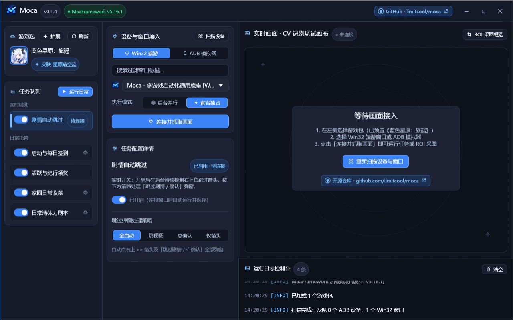

<div align="center">


# Moca

**M**odular **O**rchestration & **C**loud **A**utomation

基于 **Rust (Edition 2024) + MaaFramework + egui** 构建的多游戏通用自动化底座，已率先接入 **《蓝色星原：旅谣》（Azur Promilia）**。  
支持 **蓝色星原实机自动跳过剧情、一键批量兑换礼包码（内置公测码 + OCR 结果回传）、日常/清体力/家园托管**、Schema 驱动多游戏接入与 **Win32 端游 / ADB 模拟器**双端控制。

[](https://github.com/limitcool/moca/releases/latest)
[](LICENSE)
[](https://www.rust-lang.org/)
[](https://github.com/MaaXYZ/MaaFramework)

> **萌新直接下载（Windows 10/11 x64，免配置环境）**：  
> 👉 [**点此一键下载最新版便携包 `Moca-windows-x86_64.zip`**](https://github.com/limitcool/moca/releases/latest/download/Moca-windows-x86_64.zip) ｜ [查看所有 Releases 版本与更新说明](https://github.com/limitcool/moca/releases/latest)  
> 解压后直接双击 **`Moca.exe`** 即可使用（已内置 MaaFramework SDK、PP-OCRv5 中文识别模型、自动申请管理员权限与《蓝色星原》剧情跳过 / 批量兑换码配置，无需安装 Rust）。



</div>

---

## 功能列表

### 实机可用（《蓝色星原：旅谣》）
- **自动跳过剧情（实时触发开关 + 零硬性 `sleep` 状态机）**
  - **动态变速轮询**：非剧情画面 `1000ms` 低功耗监听；检测到右上角跳过箭头（`>>`）或确认弹窗后自动切换至 `60~80ms` 高速状态机，配合超时回退与 `inverse: true` 弹窗消失等待，**零硬性延迟**、不误点也不漏跳。
  - **多场景弹窗识别**：同时支持右上角 `>>` 跳过按钮、剧情梗概「跳过剧情」胶囊按钮以及「提示：是否确认跳过本段剧情？✓ 确认」二次确认框。
  - **四档「跳过弹窗处理策略」可调（单行切换 + 运行中热重载）**：
    - `全自动`（自动点 >> 及「跳过剧情 / ✓ 确认」全部弹窗）
    - `跳梗概`（跳过剧情梗概；普通确认框停住）
    - `点确认`（自动确认提示框；剧情梗概停住）
    - `仅箭头`（仅触发右上 >> 箭头后交由你决定）
- **批量兑换礼包码（一次性快捷工具 + Maa 原生 PP-OCRv5）**
  - **预置公测全套 13 个兑换码**：开箱即内置 `LSXY520`、`LSXYFULI`、`LSXYGONGCE` 等全部 13 个公测礼包码，支持多行自由增删、整段粘贴及一键重置默认，点击「立即执行」一次跑完。
  - **全流程 UI 自动导航与防错**：自动完成 `Esc → 设置 → 账户 → 点击兑换`，通过 Maa 原生 PP-OCRv5 识别输入框与确认按钮，依次 `Ctrl+A + Backspace` 清空残余文本后提交下一条。
  - **实时 OCR 结果回传与收尾**：每次点击确认后自动抓取弹窗提示文字（如“兑换成功，请前往邮件查看奖励”/已使用/无效）输出到运行日志并在末尾汇总；全部完成后自动点掉结果确认框并点击「取消」退回账户页。
  - **触发器智能让路**：执行期间自动暂停「剧情自动跳过」让出控制权，完成后自动恢复；剧情跳过亦内置兑换弹窗 OCR 守卫，防止误点确认按钮。
- **全局热键与前台防抢焦点**
  - **全局热键（标准 Win32 `RegisterHotKey`，无键盘钩子）**：`F8` 暂停 / 恢复实时辅助（保留勾选配置）、`F9` 0 延迟紧急急停全部任务、`F10` 显示 / 最小化 Moca 窗口；窗口内聚焦时按 `F5` 截取实时画面 / 刷新窗口列表。
  - **前台独占避让**：在前台独占模式下切回 Moca 窗口时，触发器与批处理自动静默避让焦点，不再强拉游戏回前台；切回游戏后自动继续。
- **双端窗口/设备接入与状态工作台**
  - Win32 自动按游戏正则匹配窗口、展示目标进程应用小图标、UIPI 管理员权限一致校验及后台并行 / 前台独占模式切换。
  - TOML 按游戏持久化配置（`profiles/<game_id>.toml`），内置 **ROI 采图框选工具**（实时框选截图坐标并一键导出模板 PNG）。

### 适配中 / 骨架已就绪
- **日常托管批处理**：启动与每日签到（含邮箱附件）、日常清体力刷本（副本与轮次选择）、家园收菜与奇波喂养、每日活跃与纪行领奖（模板待实机持续补充）。

---

## 核心特性

- **多游戏共用同一套底座（Game-Agnostic）**
  - 底座零硬编码任何具体游戏逻辑，完整兼容 [MaaFramework ProjectInterface v2](https://github.com/MaaXYZ/MaaFramework)（`interface.json`）并轻量扩展权限标记。
  - 新增一款游戏只需在 `games/<game_id>/` 放入 `interface.json` 与 `resource/`，底座自动生成任务列表、Toggle 开关与参数表单，按游戏独立持久化配置到 `profiles/<game_id>.toml`。
- **Win32 端游 + ADB 模拟器双端一体**
  - **Win32**：支持窗口探测、按 `title_regex` 智能匹配目标游戏窗口、UIPI 管理员权限隔离检测、后台截图 / 前台独占焦点互斥锁。
  - **ADB**：自动发现本地 Android 模拟器（MuMu 等）并调用 MaaFramework 极速截图与触控。
- **极致轻量的 Fluent 桌面端（支持“一戏一皮肤”）**
  - 基于 `egui (eframe)` + DX12 后端，结合 **Win11 Fluent 层叠质感与 HIG 一体化分段控件**，无 WebView / Node 运行时负担，内存占用低、画面预览零延迟；支持每个游戏包通过 `interface.json` 自定义专属皮肤主题。
  - **内置 ROI 采图框选工具**：直接在软件画布上拉框获取 `[x, y, w, h]` 坐标并一键裁剪保存为 `resource/image/*.png` 模板，大幅降低新游戏和版本更新适配成本。
- **Open-Core 清晰边界**
  - 日常签到、清体力、基础刷图与图像识别配置全部**开源免费**在本地执行，方便社区共建与热修；
  - 复杂动态规划/高难策略通过独立抽象层（`moca-cloud`）按需对接云端决策能力。

---

## 游戏适配进度

| 游戏 | 游戏包 ID | 支持端 | 当前状态 |
| :--- | :--- | :--- | :--- |
| **蓝色星原：旅谣** (*Azur Promilia*) | `azur-promilia` | Win32 / ADB | 🚧 **适配进行中**：已完成游戏包接入、任务 Schema、双端控制声明、**零硬性等待剧情自动跳过**、**PP-OCRv5 批量兑换礼包码**与 TOML 配置持久化，持续补齐其余实机日常模板与流程节点。 |

> **说明**：《蓝色星原：旅谣》已率先完成**自动跳过剧情**与**批量兑换礼包码（含实机 OCR 结果回传）**全流程接入；日常、清体力与家园流程骨架均已就绪，欢迎使用底座自带的 **ROI 采图框选工具** 一起补充实机图像模板与流程 PR！详情见 [CONTRIBUTING.md](CONTRIBUTING.md)。

---

## 快速上手

### 方式一：普通玩家开箱即用（推荐）

1. 前往 [**GitHub Latest Release**](https://github.com/limitcool/moca/releases/latest) 或 [**直接下载 `Moca-windows-x86_64.zip`**](https://github.com/limitcool/moca/releases/latest/download/Moca-windows-x86_64.zip)。
2. 将压缩包完整解压到任意全英文/常规文件夹（保留 `Moca.exe` 同级的 `games/`、`*.dll` 与 `plugins/`）。
3. 双击运行 **`Moca.exe`**（程序会自动申请管理员权限以适配游戏；若跳过提权可在「前台独占」或无 UIPI 限制的窗口下使用）。

### 方式二：开发者源码构建

#### 1. 环境准备

- [Rust 工具链](https://rustup.rs/)（支持 `edition = "2024"`）
- Windows 10/11（默认 DX12 渲染，可通过 `WGPU_BACKEND` 环境变量覆盖）
- **MaaFramework SDK**：从 [MaaFramework Releases](https://github.com/MaaXYZ/MaaFramework/releases) 下载对应平台的 SDK（如 `MAA-win-x86_64-v5.16.1.zip`），解压到以下任一位置：
  - 仓库根目录下的 `vendor/maa-sdk/`（确保存在 `vendor/maa-sdk/bin/MaaFramework.dll`）
  - 或者设置环境变量 `MAA_SDK_PATH` 指向解压后的 SDK 目录

#### 2. 启动运行与测试

```powershell
# 启动 Moca 桌面底座
cargo run -p moca-ui

# 运行全部单元测试（含 MaaFramework 动态加载与资源节点校验）
cargo test --workspace
```

---

## 工程架构

```text
moca/
├── .github/workflows/   # Windows x64 打 Tag 自动构建与 Release 工作流
├── assets/              # 应用图标与静态资源
├── crates/
│   ├── moca-protocol/   # ProjectInterface v2 兼容协议、pipeline_override、TOML 持久化
│   ├── moca-maa/        # MaaFramework 动态加载、Win32 图标提取/探测、UIPI 检测、Tasker 会话
│   ├── moca-runtime/    # tokio 异步运行时、多实例焦点互斥锁、游戏包扫描器
│   ├── moca-cloud/      # 策略接口抽象层
│   └── moca-ui/         # 无边框 egui 桌面端、Schema 表单渲染与热更新、ROI 采图框选工具
├── games/
│   └── azur-promilia/   # 第一款接入游戏：《蓝色星原：旅谣》
└── docs/                # 界面截图与文档资源
```

---

## 路线图 (Roadmap)

- [x] **Phase 1**：通用多游戏底座骨架（Rust Edition 2024 + `MaaFramework` 动态加载 + 无边框 `egui` 工作台）
- [x] **Phase 2**：接入《蓝色星原：旅谣》游戏包、**实机零延迟自动跳过剧情**（支持四档弹窗策略热切换）、**Maa PP-OCRv5 批量兑换礼包码与结果回传**、Win32 全局热键（`F8`/`F9`/`F10`/`F5`）与前台焦点避让、TOML 配置持久化、ROI 采图框选工具、Windows x64 Release CI
- [ ] **Phase 3**：公测开服后完善《蓝色星原：旅谣》实机日常/清体力/家园模板与流程
- [ ] **Phase 4**：资源包在线检查更新、多账号轮询队列与云端策略链路对接

---

## 致谢与声明

- 核心图像识别与控制能力基于开源项目 [MaaFramework](https://github.com/MaaXYZ/MaaFramework)（LGPL-3.0）构建。
- 本仓库代码采用 [Apache-2.0](LICENSE) 协议开源。
- 本项目仅供学习交流与研究自动化技术原理使用，请遵守各游戏厂商的用户协议并合理使用。
